# 📚 BookStore Management System

ប្រព័ន្ធគ្រប់គ្រងហាងលក់សៀវភៅ ដែលអភិវឌ្ឍដោយ **Laravel 12 + MySQL + Bootstrap 5** ផ្អែកលើ MVC។
មានការលក់ជាមួយវិក្កយបត្រ, តាមដានស្តុក, របាយការណ៍ក្រាហ្វ, ការបែងចែកសិទ្ធិ Admin/Customer, REST API និង Automated Tests។

| Login | Dashboard | POS (ការលក់) |
|---|---|---|
|  | 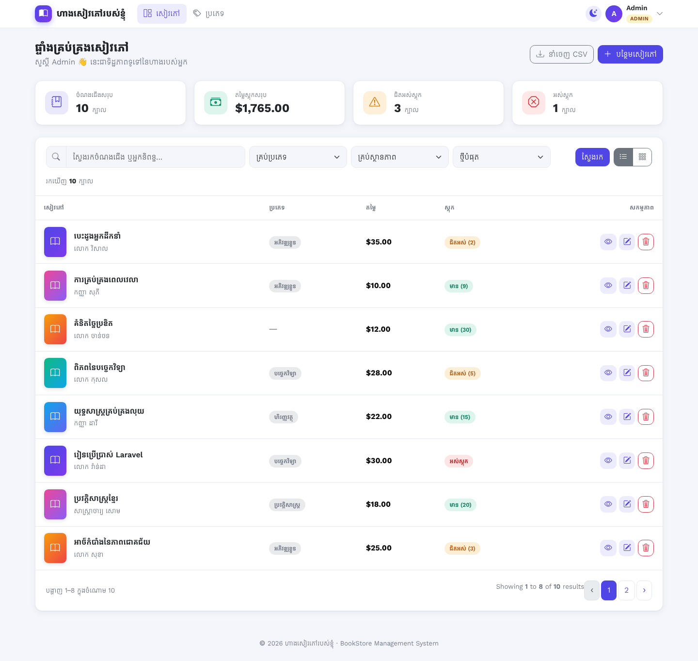 | 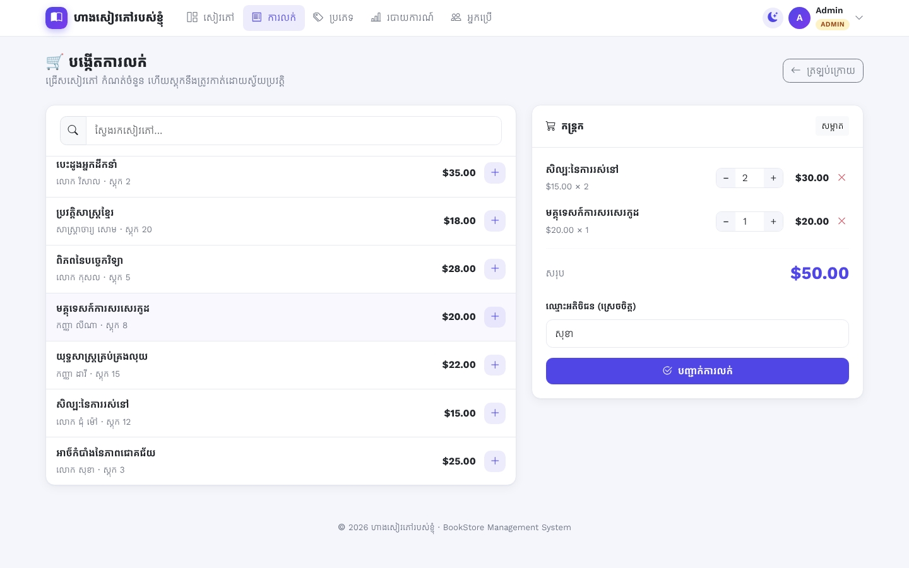 |

| Invoice | Reports | Dark mode |
|---|---|---|
| 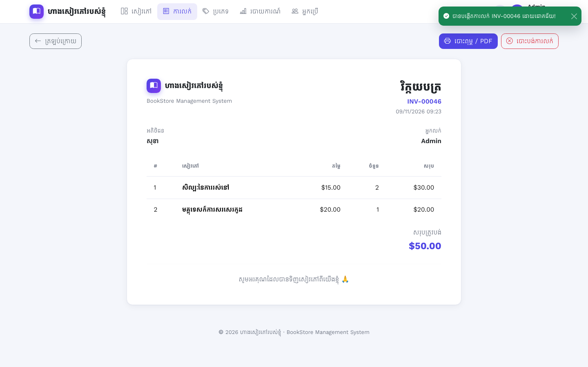 | 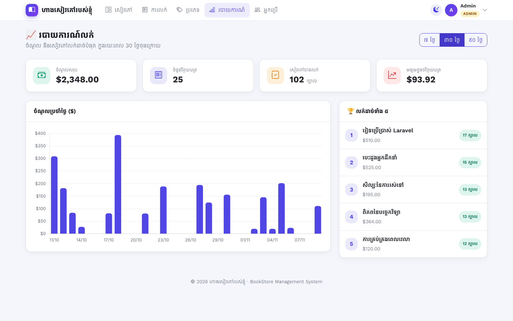 | 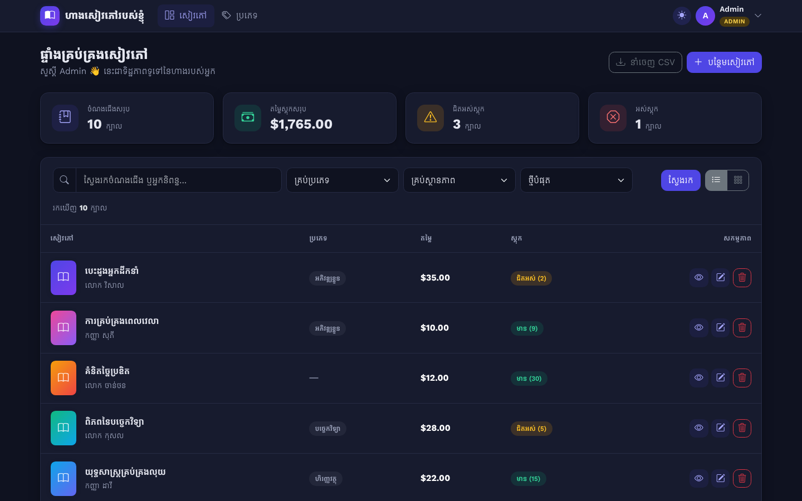 |

**ផ្នែកអតិថិជន (Customer)**

| កាតាឡុក + ចូលចិត្ត | កន្ត្រក | ការកម្មង់ដែលបានអនុម័ត |
|---|---|---|
| 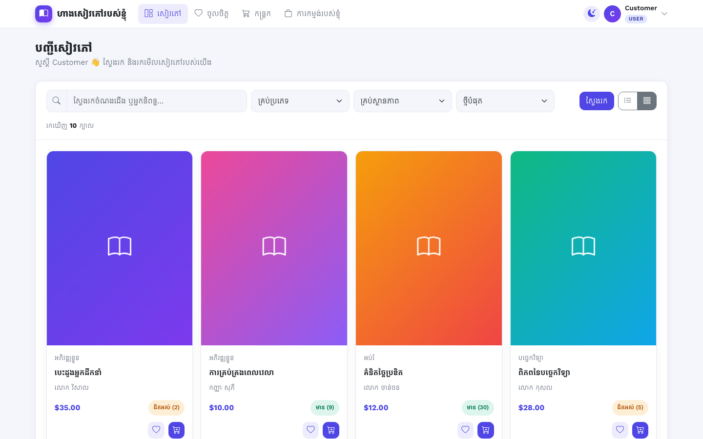 | 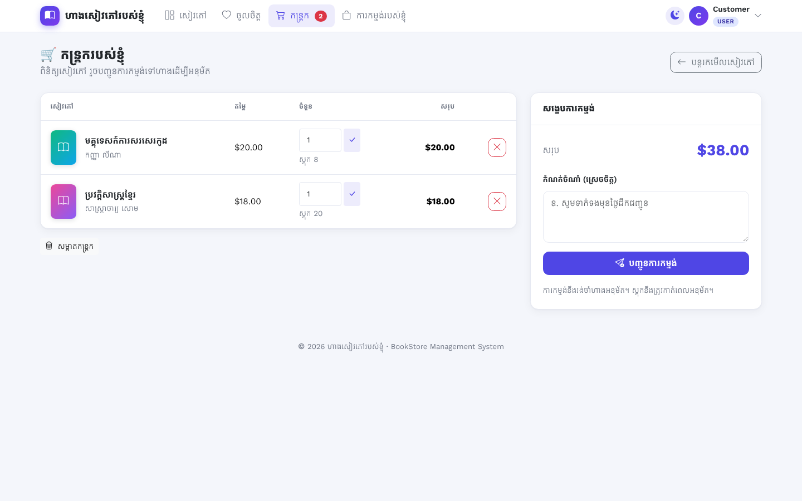 | 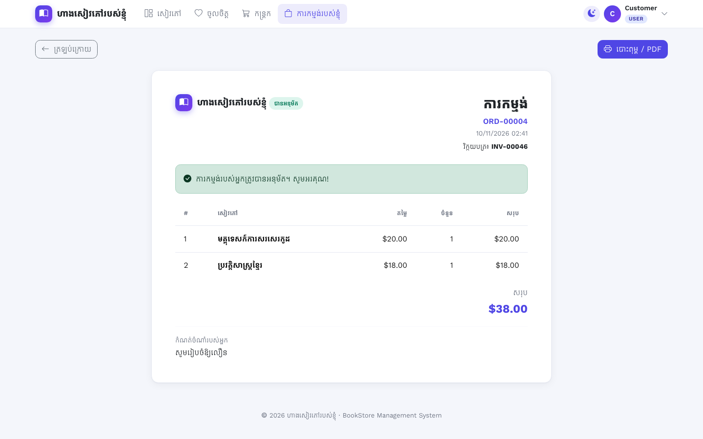 |

## ✨ មុខងារ (Features)

**សៀវភៅ & ស្តុក**
- CRUD សៀវភៅ + រូបគម្រប (preview, drag & drop, លុបរូបចាស់ស្វ័យប្រវត្តិ)
- ប្រភេទសៀវភៅ (Category), ចំនួនស្តុក, badge ស្ថានភាព (មាន / ជិតអស់ / អស់ស្តុក)
- ស្វែងរក + ត្រងតាមប្រភេទ/ស្តុក + តម្រៀប + ទិដ្ឋភាពតារាង/ក្រឡា + Pagination
- នាំចេញ CSV (UTF-8 BOM បើកក្នុង Excel បានអក្សរខ្មែរ)

**ការលក់ & របាយការណ៍**
- POS៖ ជ្រើសសៀវភៅ → កន្ត្រក → បង្កើតវិក្កយបត្រ, កាត់ស្តុកស្វ័យប្រវត្តិ
- វិក្កយបត្របោះពុម្ព/រក្សាទុកជា PDF; បោះបង់ការលក់ → ស្តុកត្រឡប់មកវិញ
- របាយការណ៍ ៧/៣០/៩០ ថ្ងៃ៖ ក្រាហ្វចំណូលប្រចាំថ្ងៃ (Chart.js), សៀវភៅលក់ដាច់ទាំង ៥

**ការទូទាត់ KHQR (Bakong)**
- បន្ទាប់ពី Admin អនុម័ត អតិថិជនឃើញ **QR ទូទាត់** + ចំនួនទឹកប្រាក់ត្រូវបង់ ហើយបញ្ចូលលេខប្រតិបត្តិការ ឬបញ្ចូលរូបថតអេក្រង់ជាភស្តុតាង
- Admin ពិនិត្យភស្តុតាង → **បញ្ជាក់ទទួលលុយ** ឬ **បដិសេធភស្តុតាង** (ស្ថានភាព: មិនទាន់ទូទាត់ → រង់ចាំផ្ទៀងផ្ទាត់ → បានទូទាត់)
- ប្តូរ QR/ឈ្មោះគណនីបានតាម `.env` (`KHQR_IMAGE`, `KHQR_ACCOUNT`) ឬ `config/bookstore.php`
- ⚠️ QR នេះជា QR ឋិតិវន្ត (static) គ្មានចំនួនទឹកប្រាក់ ហើយប្រព័ន្ធមិនភ្ជាប់ Bakong API ដូច្នេះការផ្ទៀងផ្ទាត់ធ្វើដោយ Admin ដោយដៃ

**ស្តុក & ការផ្គត់ផ្គង់**
- ISBN (unique, ស្វែងរកបាន), **ប្រវត្តិចលនាស្តុក** ទាំងអស់ (លក់ / ទិញចូល / កែ / បោះបង់) ក្នុងទំព័រសៀវភៅនីមួយៗ
- អ្នកផ្គត់ផ្គង់ + **ការទិញចូល (Purchase)** បំពេញស្តុកស្វ័យប្រវត្តិ
- Import សៀវភៅពី CSV (បង្កើត/កែ + រាយការណ៍កំហុសតាមជួរ)
- ជូនដំណឹងអ៊ីមែលទៅ Admin (កម្មង់ថ្មី, ស្តុកជិតអស់ តាម `php artisan books:low-stock` រាល់ព្រឹក ម៉ោង 8) និងអ៊ីមែលទៅអតិថិជន (អនុម័ត/បដិសេធ)

**ការវាយតម្លៃ & គណនី**
- ផ្កាយ + មតិយោបល់ លើសៀវភៅ (អ្នកដែលបានទិញប៉ុណ្ណោះ ១ ដងក្នុង១សៀវភៅ)
- ទំព័រប្រវត្តិរូប៖ ប្តូរឈ្មោះ អ៊ីមែល លេខសម្ងាត់
- GitHub Actions CI រត់ test ស្វ័យប្រវត្តិរាល់ push

**ផ្នែកអតិថិជន (Customer) — កម្មង់អនឡាញ**
- បញ្ជីចូលចិត្ត (Wishlist), កន្ត្រក (កំណត់ចំនួនមិនឱ្យលើសស្តុក), បញ្ជូនការកម្មង់ជាមួយកំណត់ចំណាំ
- ប្រវត្តិការកម្មង់ + ស្ថានភាព (រង់ចាំ / អនុម័ត / បដិសេធ / បោះបង់) និងបោះបង់បាន ពេលនៅរង់ចាំ
- **Admin អនុម័ត** → ស្តុកថយ + បង្កើតវិក្កយបត្រស្វ័យប្រវត្តិ ឬ **បដិសេធ** ជាមួយមូលហេតុ
- អតិថិជនមិនឃើញព័ត៌មានផ្ទៃក្នុងហាង (ស្ថិតិ, តម្លៃស្តុកសរុប) ហើយមើលការកម្មង់អ្នកដទៃមិនបាន

**អ្នកប្រើប្រាស់ & សុវត្ថិភាព**
- Register/Login (validate, remember me), បែងចែកសិទ្ធិ **Admin / Customer** តាម middleware
- Admin គ្រប់គ្រងអ្នកប្រើ: ប្តូរតួនាទី, លុប (ការពារកុំឱ្យប្តូរ/លុបខ្លួនឯង)
- REST API ជាមួយ Laravel Sanctum token

**UI/UX**: Responsive, Dark/Light mode, Toast, Modal បញ្ជាក់ការលុប, ពុម្ពអក្សរ Kantumruy Pro

## 🧠 ចំណុចបច្ចេកទេសសំខាន់ៗ
- **Database transaction + `lockForUpdate()`** ពេលលក់ ដើម្បីការពារស្តុកអវិជ្ជមាន/លក់ជាន់គ្នា
- **Snapshot តម្លៃ & ឈ្មោះ** ក្នុង `sale_items` ដូច្នេះវិក្កយបត្រចាស់មិនប្តូរពេលកែ/លុបសៀវភៅ
- Query scopes (`search`, `stockStatus`) + whitelist សម្រាប់ sort (ការពារ SQL injection)
- Role check ដោយ middleware `admin`; user ចុះឈ្មោះថ្មីតែងតែជា `user` (មិនទទួល `role` ពី request)
- `SaleService` តែមួយ ប្រើរួមគ្នាទាំងការលក់ផ្ទាល់ និងការអនុម័តការកម្មង់ (DRY, កាត់ស្តុកក្នុង transaction តែមួយ)
- ការអនុម័តការកម្មង់ lock ជួរ order ការពារអនុម័តពីរដង, ហើយពិនិត្យស្តុកម្តងទៀត ពេលអនុម័ត (ស្តុកអាចប្តូរក្រោយកម្មង់)
- Authorization ផ្នែកទិន្នន័យ៖ អតិថិជនចូលមើល/បោះបង់ការកម្មង់របស់អ្នកដទៃ → 403
- Feature tests ៥៨ ករណី (សិទ្ធិ, ការលក់, ស្តុក, កន្ត្រក, កម្មង់, ទូទាត់, ការទិញចូល, review, import, API, validation)

## 🚀 ដំឡើង (Setup)

```bash
composer install
cp .env.example .env          # កំណត់ DB_* ឱ្យត្រូវ MySQL របស់អ្នក
php artisan key:generate
php artisan migrate --seed    # បង្កើតតារាង + ទិន្នន័យគំរូ + ការលក់គំរូ
php artisan storage:link      # ឱ្យរូបគម្របបង្ហាញបាន
php artisan serve
```

គណនីសាកល្បង (បន្ទាប់ពី `--seed`): `admin@example.com` / `password` (Admin) · `user@example.com` / `password` (Customer)

## ✅ Tests
```bash
php artisan test
```

## 🔌 REST API
| Method | Endpoint | សិទ្ធិ |
|---|---|---|
| POST | `/api/register`, `/api/login` | សាធារណៈ → ទទួល Bearer token |
| GET | `/api/books` | ទាមទារ token |
| POST | `/api/books` | Admin |
| DELETE | `/api/books/{id}` | Admin |

## 🗂️ រចនាសម្ព័ន្ធ
`app/Http/Controllers` (Book, Category, Sale, Report, User, WebAuth, Api/*) · `app/Models` (Book, Category, Sale, SaleItem, User) · `resources/views` (Blade) · `tests/Feature/BookStoreTest.php`

## 💳 ទូទាត់ & ✨ មុខងារបន្ថែម (រូបអេក្រង់)

| QR ទូទាត់ (អតិថិជន) | ផ្ទៀងផ្ទាត់ភស្តុតាង (Admin) | ទំព័រសៀវភៅ: ការវាយតម្លៃ + ចលនាស្តុក |
|---|---|---|
| 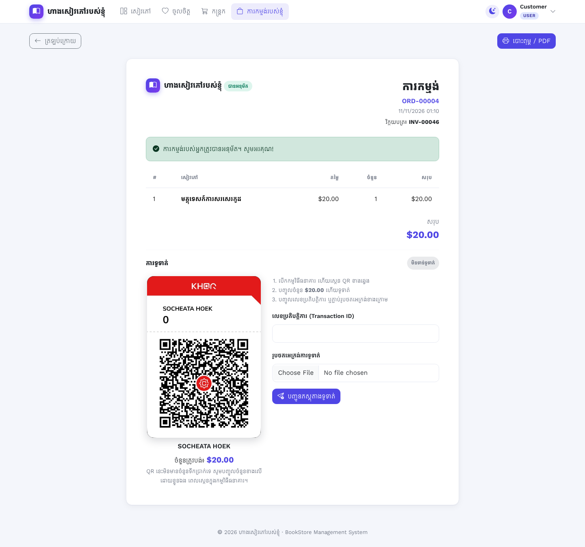 | 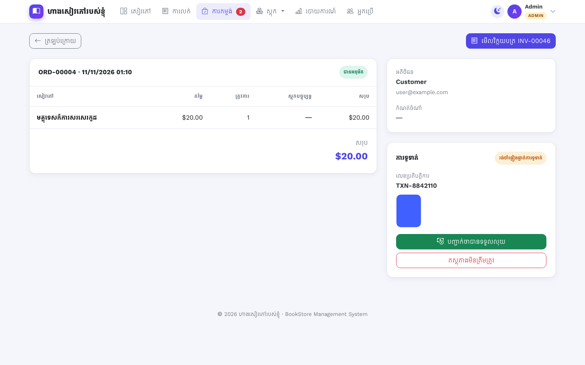 | 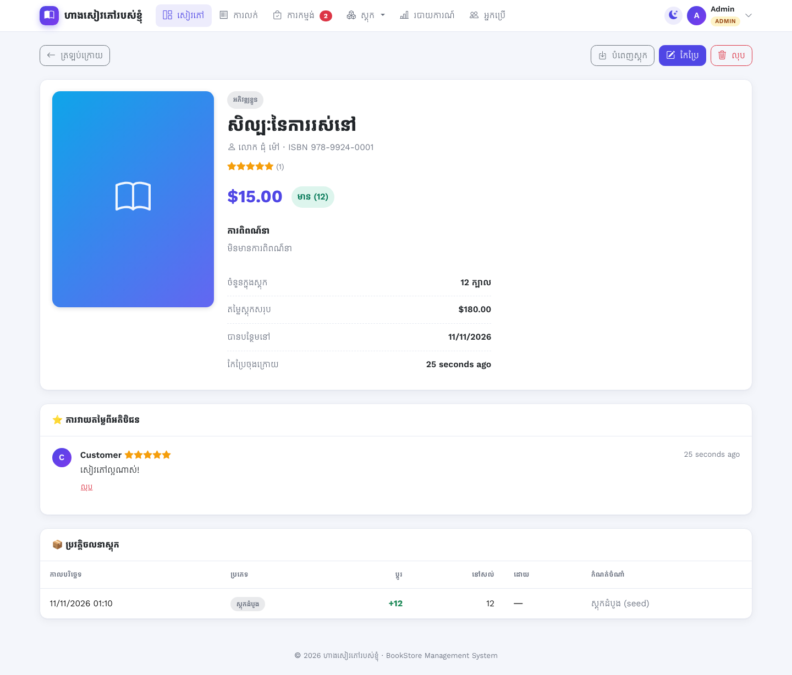 |

## 💳 បង់ប្រាក់ភ្លាម + ជូនដំណឹងម្ចាស់ហាង (v5)

- អតិថិជនកម្មង់រួច **ឃើញ QR ភ្លាម** ហើយបង់បាន មិនចាំ Admin អនុម័តទេ។
- Admin ទទួល **កណ្ដឹង 🔔 + toast + សំឡេង** (ពិនិត្យរាល់ ១៥ វិនាទី) ពេលមានការកម្មង់ថ្មី និងពេលមានអ្នកបង់លុយ។
- ប៊ូតុង «បញ្ជាក់ទទួលលុយ + អនុម័តភ្លាម» ធ្វើ ២ ជំហានក្នុងមួយចុច (កាត់ស្តុក + បង្កើតវិក្កយបត្រ)។
- Telegram (ស្រេចចិត្ត): ដាក់ `TELEGRAM_BOT_TOKEN` និង `TELEGRAM_CHAT_ID` ក្នុង `.env`។
- ត្រូវ `php artisan migrate` (តារាង notifications ថ្មី)។ Tests: 69 ជាប់ · មានប៊ូតុង «ទិញភ្លាម» និងប៊ូតុងបង់ «ខ្ញុំបានបង់ហើយ» (គ្មានការបំពេញលេខប្រតិបត្តិការ)។

## 🚀 Deploy · Docker · API · Demo (v5.1)
- `docker compose up --build` → http://localhost:8000 (MySQL + seed + demo login)
- `DEPLOY.md` — deploy ឥតគិតថ្លៃលើ Render (`render.yaml`)
- `docs/API.md` + `docs/bookstore.postman_collection.json` — REST API (Sanctum)
- `BOOKSTORE_DEMO=true` → ប៊ូតុង «ចូលជា Admin / អតិថិជន» លើទំព័រ login (កុំបើកនៅហាងពិត)
- Tests: 71 ជាប់
